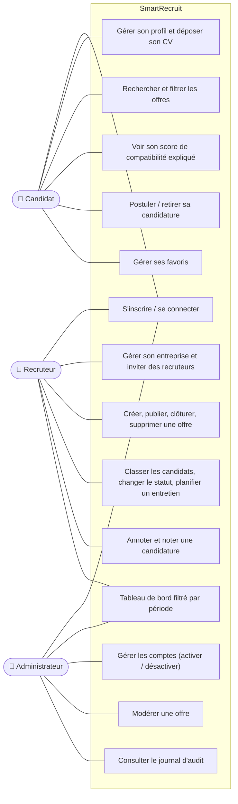
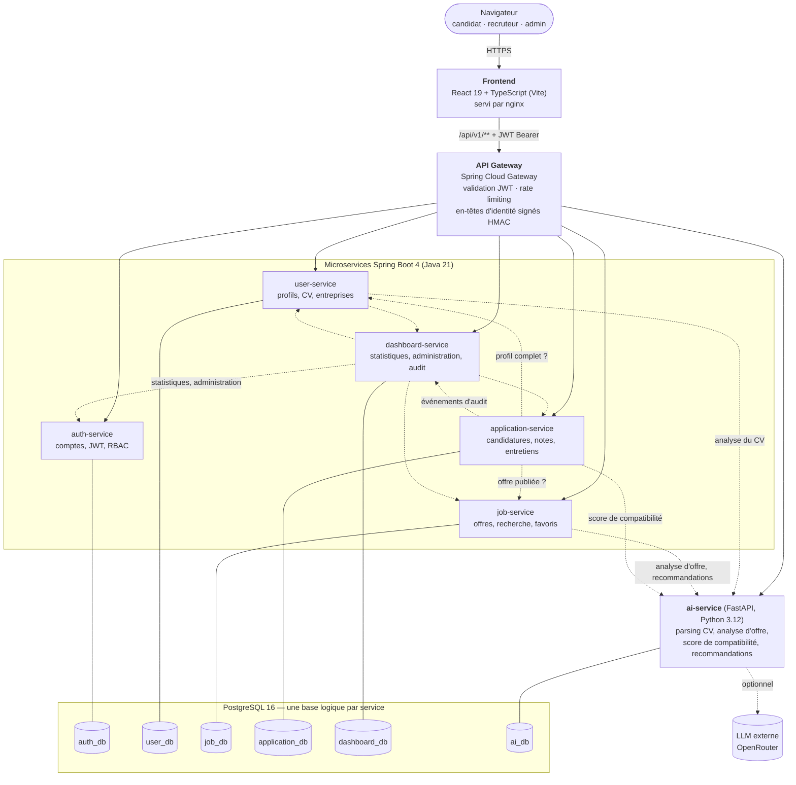
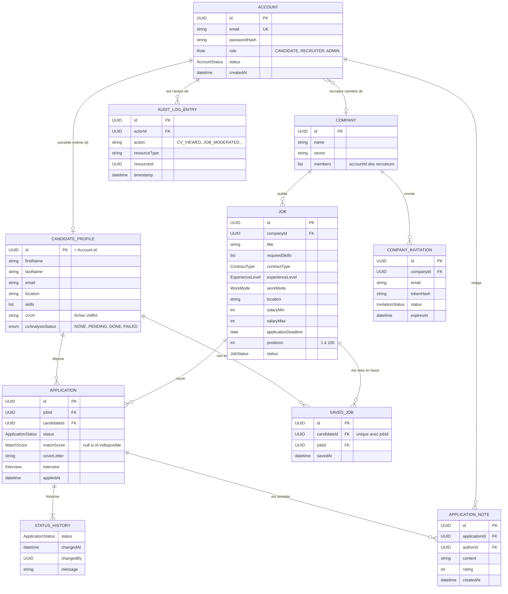
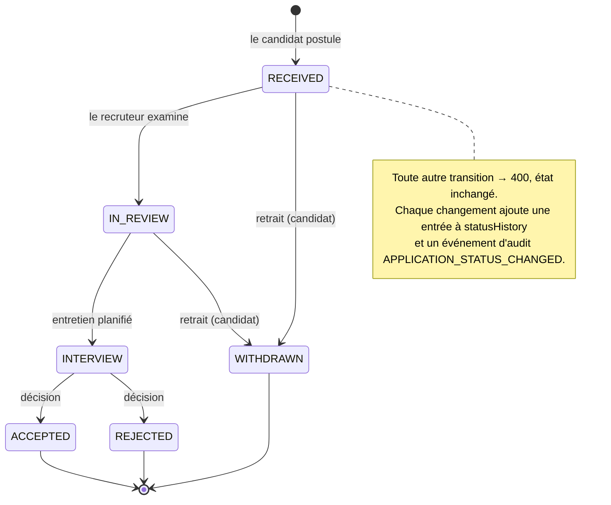
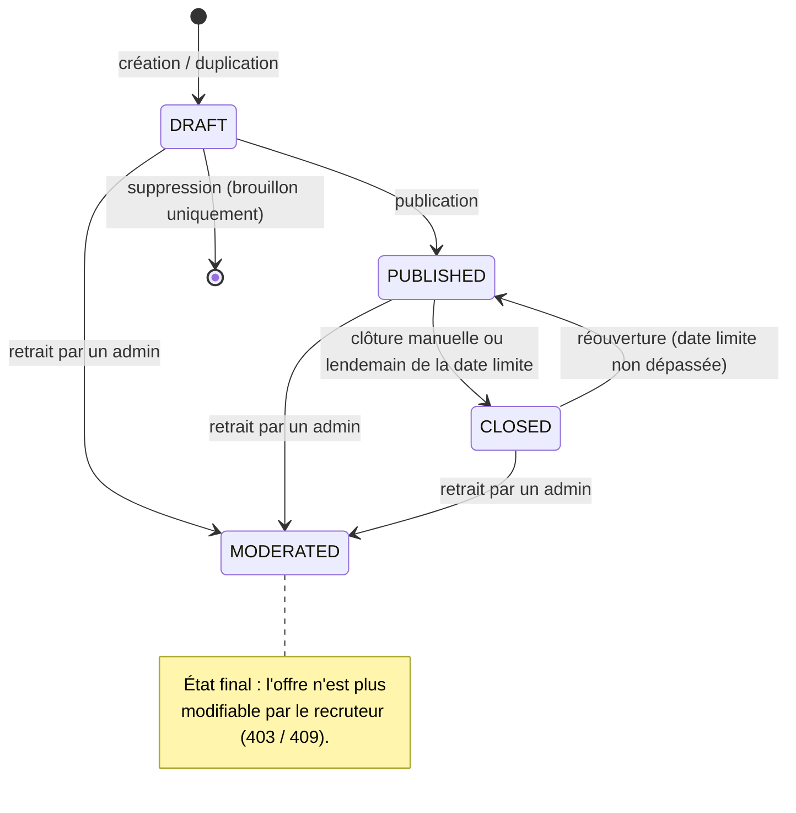
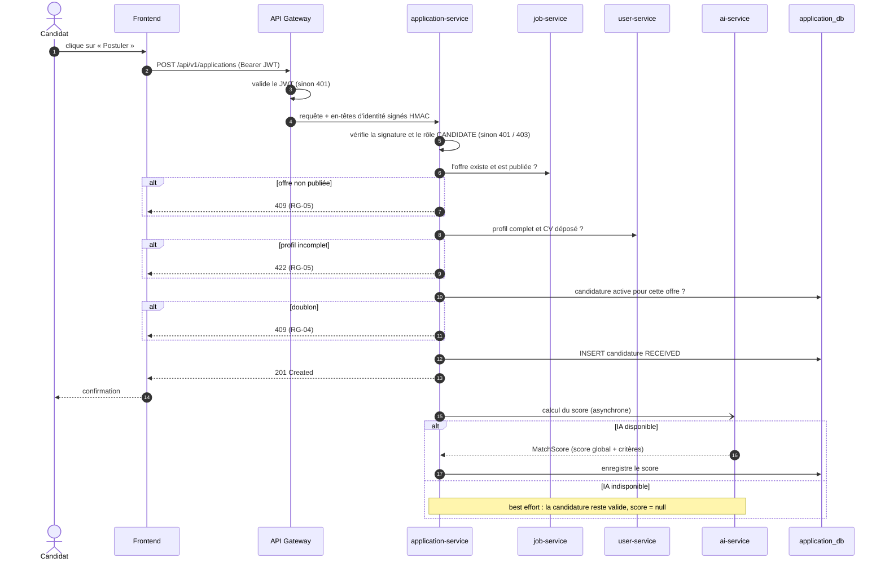
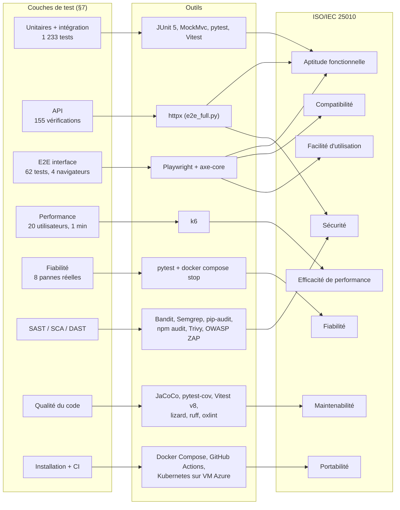

# Diagrammes — SmartRecruit (Mermaid)

Diagrammes du [rapport de conception](RAPPORT_CONCEPTION.md), au format Mermaid : GitHub les affiche directement ;
pour une image, coller le code dans https://mermaid.live puis exporter en PNG ou SVG.

## 1. Cas d'utilisation par rôle

## 2. Architecture

## 3. Modèle de données

Entre microservices, les clés étrangères sont **logiques** (chaque service possède sa base).

## 4. Workflow d'une candidature (RG-03)

## 5. Workflow d'une offre (RG-08, RG-09)

## 6. Séquence : postuler à une offre

## 7. Stratégie de test : couches → outils → caractéristiques ISO/IEC 25010

## 8. Pipeline CI/CD (GitHub Actions)

```mermaid
flowchart LR
    P(["push / pull request"]) --> S1
    subgraph S1["1 · Tests"]
        B["Backend ×6<br/>JUnit + JaCoCo"]
        F["Frontend<br/>Vitest + couverture, npm audit"]
        I["Service IA<br/>pytest-cov, Bandit, pip-audit"]
    end
    subgraph S2["2 · Validation de l'infrastructure"]
        K["Kustomize"]
        H["Helm"]
        TF["Terraform"]
        AN["Ansible"]
    end
    subgraph S3["3 · Images"]
        IM["8 images Docker"]
    end
    subgraph S4["4 · Déploiement (main uniquement)"]
        D["VM Azure<br/>Kubernetes kind via Ansible"]
    end
    subgraph S5["5 · Tests de fumée"]
        SM["Smoke tests sur la VM"]
    end
    S1 --> S2 --> S3 --> S4 --> S5
```

