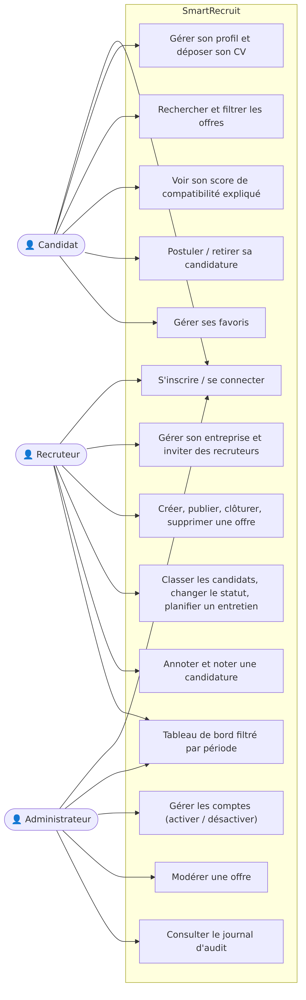
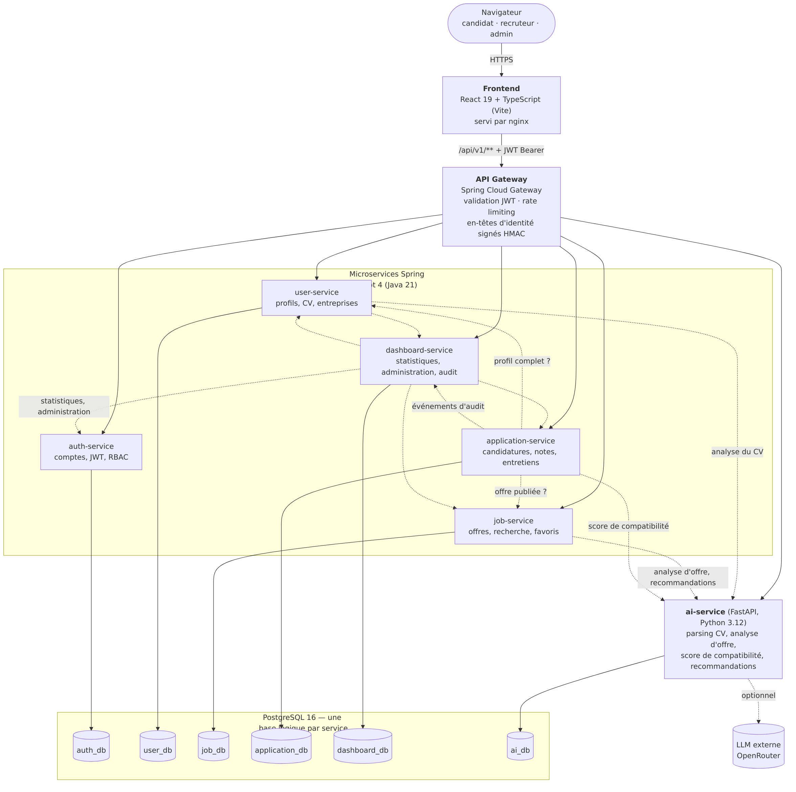
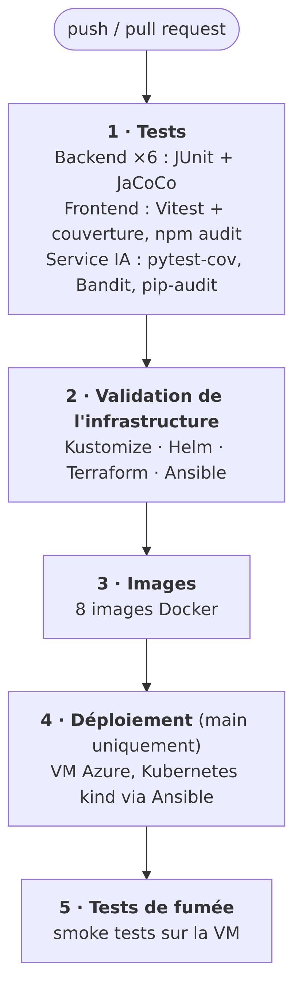
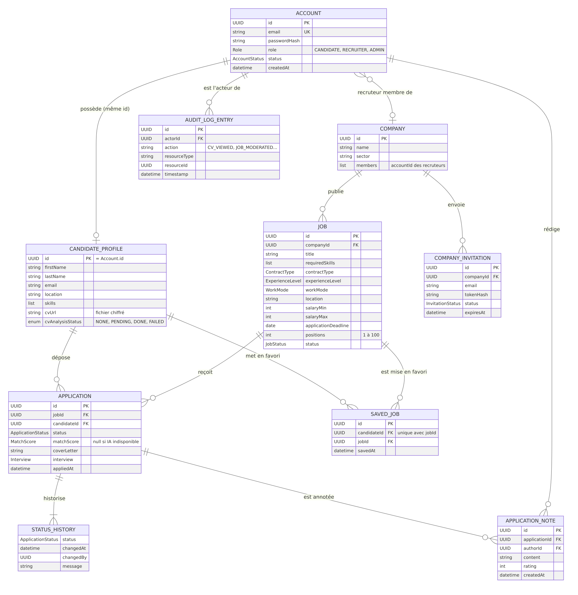
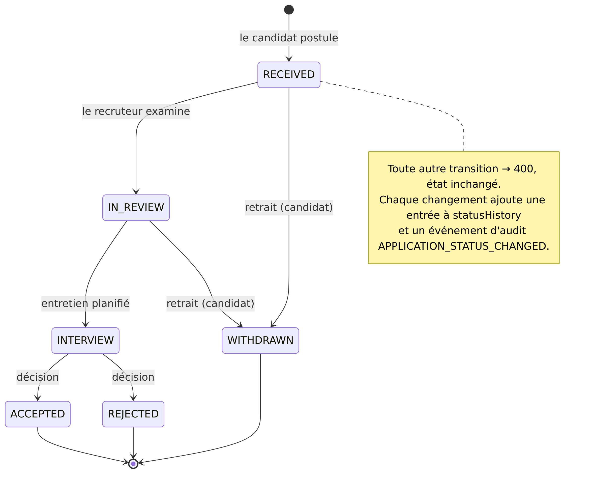
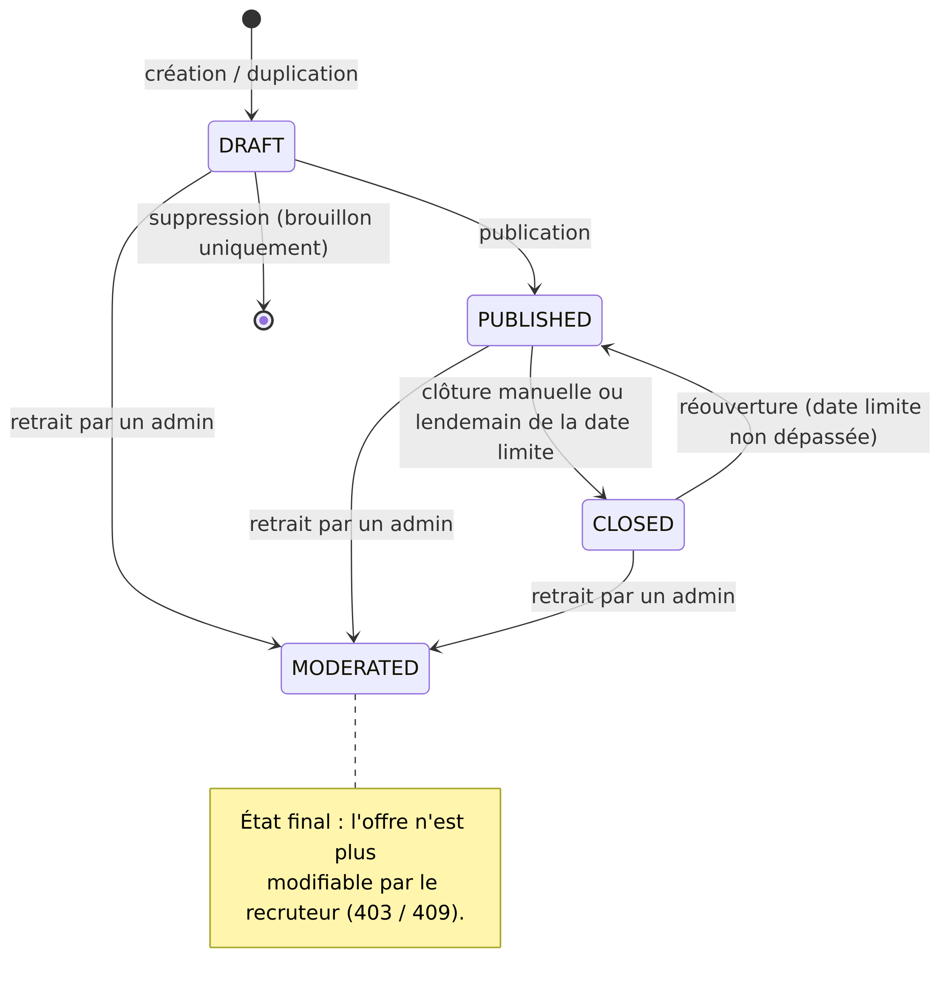
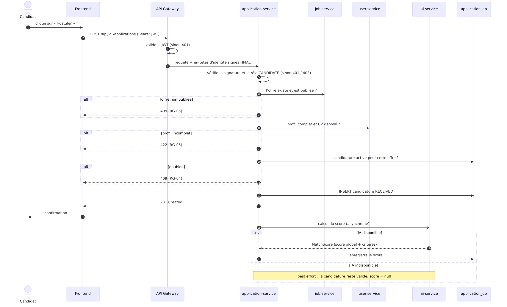
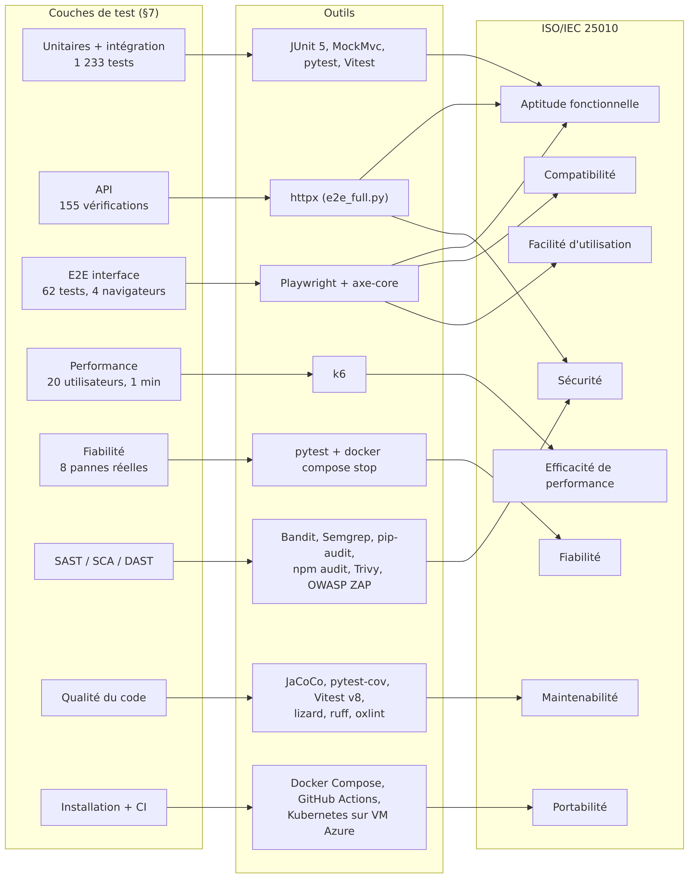

# Rapport de conception — SmartRecruit

> Module Qualité et Automatisation des Tests — ING 5 GLSI — projet conforme ISO/IEC 25010.
> Groupe : *(noms des membres à compléter)*.

## 1. Domaine et périmètre

**Domaine : ressources humaines / recrutement.** SmartRecruit est une plateforme de recrutement assistée par IA :
les recruteurs publient des offres, les candidats déposent leur CV, et un service IA calcule un score de compatibilité
expliqué critère par critère.

Couverture des exigences fonctionnelles minimales du cahier des charges (§4) :

| Exigence du cahier des charges | Réalisation dans SmartRecruit |
|---|---|
| ≥ 3 profils, droits différenciés | `CANDIDATE`, `RECRUITER`, `ADMIN` ; JWT validé au gateway, RBAC par `@PreAuthorize` dans chaque service ; routes frontend protégées par rôle (`RequireRole`) |
| ≥ 4 entités liées (1-N, N-N), CRUD | `Account`, `CandidateProfile`, `Company`, `Job`, `Application`, `ApplicationNote`, `SavedJob`, `CompanyInvitation`, `AuditLogEntry` (§3) |
| ≥ 1 workflow à statuts | Candidature `RECEIVED → IN_REVIEW → INTERVIEW → {ACCEPTED, REJECTED}`, retrait `WITHDRAWN` ; offre `DRAFT → PUBLISHED ⇄ CLOSED`, `MODERATED` (§4) |
| Tableau de bord (indicateurs agrégés, filtres) | Admin : offres actives, candidatures, utilisateurs par rôle, score moyen ; recruteur : offres publiées, candidatures reçues, taux d'acceptation, entonnoir par statut, délai moyen de décision, entretiens à venir ; **filtre par période** (7 / 30 / 90 jours, 12 mois) sur les deux tableaux de bord (`?from=&to=`) |
| Recherche / filtrage sur une entité à fort volume | Recherche d'offres paginée : mot-clé, ville, compétences, contrat, niveau, mode de travail, salaire minimum ; **3 068 offres publiées** (`backend/seed/seed_volume.py`, paramétrable avec `VOLUME`) |
| Journal d'audit | `dashboard-service` : `AuditLogEntry (actorId, action, resourceType, resourceId, timestamp)` ; consultation de CV, changement de statut, modération, (dés)activation de compte ; filtres date / auteur / action |
| ≥ 5 règles métier testables | 9 règles `RG-01` à `RG-09` (§5) |

## 2. Architecture

- **6 microservices Spring Boot 4 (Java 21)** + **1 service IA FastAPI (Python 3.12)** + **SPA React**.
- **Architecture en couches dans chaque service** : `controller/ → service/ → repository/ → model/`, plus `dto/`,
  `config/`, `security/`, `exception/`, `client/` (appels inter-services). Le frontend sépare `api/` (accès HTTP),
  `auth/`, `components/`, `pages/`, `lib/`.
- **Sécurité par conception** : seul le gateway est exposé côté navigateur ; il valide le JWT puis transmet l'identité
  dans des en-têtes signés HMAC-SHA256 que chaque service vérifie (un appel direct sans signature est rejeté en 401).
  Toutes les chaînes JSON entrantes sont assainies (jsoup) contre le XSS ; accès aux données uniquement par JPA/JPQL
  paramétré (pas d'injection SQL).
- **Tolérance aux pannes par conception** : l'IA est appelée en « best effort » (une offre ou une candidature reste
  valide si l'IA est indisponible, le score reste `null`) ; l'analyse IA d'une offre échouée est relancée
  automatiquement ; le gateway échoue en moins de 3 s si un service est arrêté.
- **Déploiement** : Docker Compose (local), Kubernetes (Kustomize, Helm), Terraform, Ansible, CI/CD GitHub Actions avec
  déploiement sur une VM Azure et tests de fumée. Observabilité : Prometheus/Grafana, ELK. Détails : [DEVOPS.md](../DEVOPS.md).

## 3. Modèle de données

Référence complète : [DATA_MODEL.md](../DATA_MODEL.md) et [API_CONTRACTS.md](../API_CONTRACTS.md).

| Relation | Cardinalité | Mise en œuvre |
|---|---|---|
| Company — Job | 1-N | `Job.companyId` |
| Job — Application | 1-N | `Application.jobId` |
| Candidat — Job | **N-N** via `Application` (entité d'association portant statut, score, historique) | `(candidateId, jobId)` |
| Candidat — Job (favoris) | **N-N** via `SavedJob` | clé unique `(candidateId, jobId)` |
| Company — Recruteurs | 1-N | `Company.members` (un recruteur n'appartient qu'à une entreprise) |
| Application — ApplicationNote | 1-N | `ApplicationNote.applicationId` (clé étrangère JPA) |
| Account — CandidateProfile | 1-1 | même identifiant |

Entre microservices, les clés sont des **clés étrangères logiques** (chaque service possède sa base) ; la cohérence est
garantie par les appels inter-services (ex. une candidature vérifie que l'offre existe et est `PUBLISHED`).

CRUD complet (les 4 opérations) sur 6 entités :

| Entité | Créer | Lire | Modifier | Supprimer |
|---|---|---|---|---|
| Compte | `POST /auth/register` | `GET /auth/me`, liste admin | (dés)activation admin, réinitialisation du mot de passe | effacement RGPD avec le profil candidat |
| Profil candidat | `PUT /users/candidates/me` (1re fois) | `GET /users/candidates/me` | `PUT` / `PATCH /users/candidates/me`, dépôt de CV | `DELETE /users/candidates/me?confirm=true` |
| Offre | `POST /jobs`, duplication | `GET /jobs`, `GET /jobs/{id}` | `PATCH /jobs/{id}`, statut | `DELETE /jobs/{id}` (brouillon ; une offre publiée se clôture) |
| Candidature | `POST /applications` | `GET /applications/me`, par offre | changement de statut, entretien | `DELETE /applications/{id}` (retrait logique `WITHDRAWN`) |
| Note d'équipe | `POST /applications/{id}/notes` | `GET …/notes` | `PUT …/notes/{noteId}` (auteur) | `DELETE …/notes/{noteId}` (auteur) |
| Favori | `PUT /jobs/{id}/saved` | `GET /jobs/saved` | — (aucun attribut modifiable) | `DELETE /jobs/{id}/saved` |

Entreprises : création, lecture, modification, invitations (pas de suppression : les offres et candidatures en dépendent).

## 4. Workflows à statuts

**Candidature** (`ApplicationStatus.ALLOWED_TRANSITIONS`) :

Toute autre transition est rejetée en 400 ; chaque changement ajoute une entrée à `statusHistory` et un événement
d'audit `APPLICATION_STATUS_CHANGED`.

**Offre** : `DRAFT → PUBLISHED`, `PUBLISHED → CLOSED`, `CLOSED → PUBLISHED` ; `MODERATED` (retrait par un admin) bloque
toute modification ; clôture automatique au lendemain de la date limite.

**Postuler à une offre** : le diagramme de séquence ci-après détaille le parcours de bout en bout (contrôle d'accès,
vérifications RG-04 et RG-05, score IA asynchrone en « best effort »).

## 5. Règles métier explicites et testables

| Id | Règle | Comportement attendu | Tests |
|---|---|---|---|
| RG-01 | Unicité de l'email d'un compte | 2e inscription avec le même email → 409 | `RegisterIntegrationTest.registerWithExistingEmailReturns409` ; e2e API |
| RG-02 | Un recruteur n'appartient qu'à une seule entreprise | 2e création d'entreprise → 409 | e2e API « seconde entreprise du même recruteur refusée » |
| RG-03 | Transitions de statut de candidature contrôlées | transitions hors table → 400, état inchangé | `StatusChangeIntegrationTest.transitionTableIsEnforced` (paramétré) ; fiabilité `test_transition_interdite_rejetee_sans_modifier_l_etat` |
| RG-04 | Une seule candidature active par candidat et par offre | doublon → 409 ; possible à nouveau après retrait | `ApplyIntegrationTest.canApplyAgainAfterWithdrawing`, `sameJobFromAnotherCandidateIsNotADuplicate` ; fiabilité `test_double_candidature_rejetee_pas_de_doublon` |
| RG-05 | Postuler exige une offre publiée, un profil complet et un CV | offre non publiée → 409 ; profil incomplet → 422 | `ApplyIntegrationTest.unpublishedJobGets409`, `incompleteProfileGets422` |
| RG-06 | Anti-force brute | 5 échecs en 15 min verrouillent le compte ; 10 requêtes / 5 min / IP sur la connexion et l'inscription, puis 429 | `LoginIntegrationTest.fiveFailuresWithin15MinutesLockTheAccount` ; `RateLimitingIntegrationTest` ; preuve d'exécution réelle `quality/reports/security/rate-limit-429.txt` |
| RG-07 | Un administrateur ne peut pas se désactiver lui-même | 400 | `AdminUserIntegrationTest.anAdminCannotDisableThemself` |
| RG-08 | Cohérence des offres : `salaryMin ≤ salaryMax`, 1 à 100 postes, clôture automatique après la date limite | 400 ; passage en `CLOSED` | `JobEnrichmentIntegrationTest.patchChecksTheSalaryRangeAgainstTheStoredBound`, `expiredOffersAreClosedAndCannotBeReopened` |
| RG-09 | Workflow des offres ; une offre modérée n'est plus modifiable | transition interdite → 400 ; offre `MODERATED` → 403/409 | `JobStatusIntegrationTest.forbiddenTransitionsGet400AndNothingChanges`, `moderatedOfferIsOutOfTheRecruitersHands` ; `JobUpdateIntegrationTest.closedAndModeratedOffersGet409` |

## 6. Choix techniques justifiés

- **Spring Boot (Java 21)** pour le cœur métier : écosystème mature pour la sécurité (Spring Security), la persistance
  (JPA) et les tests d'intégration (MockMvc, H2), adapté à une architecture en couches et en microservices.
- **FastAPI (Python)** pour l'IA : l'écosystème Python est la référence pour le traitement de CV (extraction PDF,
  règles, appel LLM) ; FastAPI apporte la validation par schémas (Pydantic) et une documentation OpenAPI automatique.
- **React + TypeScript** : typage statique partagé avec les contrats d'API, tests de composants rapides (Vitest,
  Testing Library) ; **PostgreSQL** pour l'intégrité transactionnelle ; **Docker Compose / Kubernetes** pour une
  installation reproductible (portabilité).

## 7. Qualité intégrée dès la conception (ISO/IEC 25010)

| Caractéristique | Décision de conception |
|---|---|
| Aptitude fonctionnelle | Contrats d'API écrits avant le code (`API_CONTRACTS.md`), enums partagés à l'identique entre les 3 composants |
| Efficacité de performance | Pagination systématique (`size ≤ 50`), cache des scores IA `(candidat, offre)`, appels IA asynchrones |
| Compatibilité | SPA standard (pas d'API propriétaire navigateur), API REST/JSON, service IA interchangeable (règles ou LLM externe OpenRouter) |
| Facilité d'utilisation | Libellés visibles sur tous les champs, messages d'erreur explicites, lien d'évitement, navigation clavier, mise en page mobile |
| Fiabilité | IA « best effort », relance automatique des analyses, délai de connexion borné au gateway, transactions JPA |
| Sécurité | JWT + RBAC, en-têtes internes signés, assainissement XSS, requêtes paramétrées, rate limiting, CV chiffrés, effacement RGPD |
| Maintenabilité | Couches strictes, un service par domaine, tests à chaque couche, lint (ruff, oxlint) en CI |
| Portabilité | Images Docker pour chaque composant, configuration par variables d'environnement, manifestes Kubernetes/Helm |

